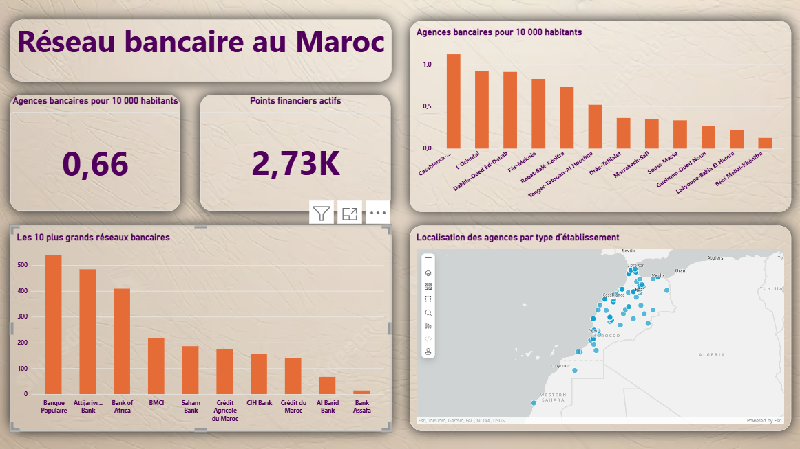
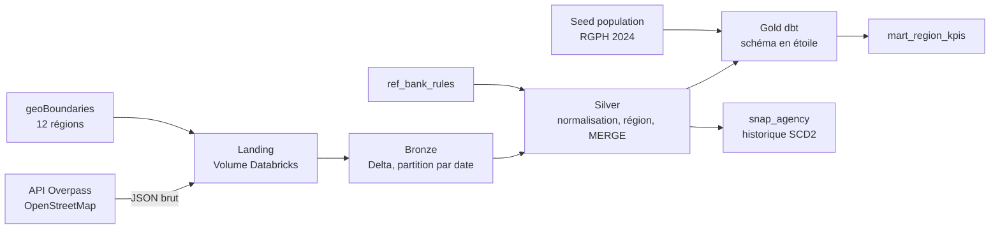

# Morocco Bank Network Lakehouse

Pipeline de données quotidien qui collecte les agences bancaires du Maroc depuis
OpenStreetMap, les normalise, les rattache à leur région et calcule des indicateurs
d'accès au réseau bancaire par habitant. Construit sur Databricks avec Delta Lake,
PySpark et dbt.

**Question métier :** comment le réseau d'agences bancaires est-il réparti entre
les 12 régions du Maroc, rapporté à leur population ?



## Architecture



Un job Databricks enchaîne chaque nuit `download_osm → bronze_osm → silver_osm → dbt_build`.

## Ce que fait chaque couche

| Couche | Rôle | Techniques |
|---|---|---|
| Landing | Réponse brute de l'API, un dossier par date de collecte | Retries avec backoff exponentiel, contrôle du volume avant écriture |
| Bronze | Une ligne par objet OSM, valeurs non modifiées | Schéma explicite, tags OSM en `map`, partition par date, relance idempotente (`replaceWhere`) |
| Silver | Une ligne par agence, propre et à jour | Normalisation multilingue (français, arabe, tifinagh) par règles priorisées, jointure spatiale avec les régions, quarantaine, `MERGE` incrémental avec empreinte SHA-256, désactivation des agences disparues |
| Gold | Modèle analytique | dbt : `dim_bank`, `dim_region`, `fact_agency`, `mart_region_kpis`, seed de population, snapshot SCD2 |

## Qualité des données

- **25 tests dbt** à chaque exécution : unicité, valeurs non nulles, valeurs acceptées, intégrité référentielle entre faits et dimensions.
- **Test métier** : la population totale des régions doit rester entre 36 et 37,5 millions. Ce test a été ajouté après avoir détecté une erreur de saisie dans le seed.
- **Garde-fou** : le `MERGE` silver est annulé si la collecte du jour contient moins de 1 000 agences, pour ne jamais désactiver tout le réseau sur une collecte vide.
- **Lignes en échec conservées** (`store_failures`) pour faciliter le diagnostic.

## Chiffres clés

- 2 728 objets OpenStreetMap marqués comme banque au Maroc (collecte du 6 novembre 2026)
- 97,6 % des agences avec un nom rattachées à un établissement normalisé, 0 rattachement ambigu
- 125 points identifiés comme établissements non bancaires (transfert d'argent, crédit, change)
- 100 % des agences rattachées à une région
- Premier chargement incrémental : 1 agence désactivée entre le 6 et le 7 novembre, 2 727 inchangées et non réécrites

## Premiers résultats

| Région | Agences bancaires | Pour 10 000 habitants |
|---|---:|---:|
| Casablanca-Settat | 860 | 1,12 |
| L'Oriental | 211 | 0,92 |
| Dakhla-Oued Ed-Dahab | 20 | 0,91 |
| Fès-Meknès | 369 | 0,83 |
| Rabat-Salé-Kénitra | 377 | 0,73 |
| Tanger-Tétouan-Al Hoceïma | 209 | 0,52 |
| Drâa-Tafilalet | 60 | 0,36 |
| Marrakech-Safi | 169 | 0,35 |
| Souss-Massa | 101 | 0,33 |
| Guelmim-Oued Noun | 12 | 0,27 |
| Laâyoune-Sakia El Hamra | 10 | 0,22 |
| Béni Mellal-Khénifra | 32 | 0,13 |

**Ces chiffres décrivent le réseau tel qu'il est cartographié dans OpenStreetMap, pas le
réseau officiel.** Certaines valeurs basses, comme Marrakech-Safi ou Béni Mellal-Khénifra,
reflètent probablement un manque de cartographie. Une comparaison avec les chiffres
officiels de Bank Al-Maghrib est prévue pour mesurer la couverture d'OSM par région.

## Choix techniques

- **Règles de normalisation dans une table de référence**, séparées du code : une nouvelle variante de nom demande une ligne, pas une modification du pipeline.
- **Départage déterministe** des règles en cas d'égalité, pour qu'une relance donne toujours le même résultat.
- **Jointure sur les codes ISO des régions** (`MA-01` à `MA-12`) plutôt que sur les noms, qui diffèrent d'une source à l'autre.
- **Évolution du schéma sans suppression** : ajout de colonnes avec `ALTER TABLE`, puis remplissage par le `MERGE`.
- **Production exécutée depuis GitHub** (branche `main`), jamais depuis un brouillon.

## Limites connues

- OpenStreetMap n'est pas exhaustif, et sa couverture varie selon les régions.
- Un changement dans OSM peut être une correction de la carte plutôt qu'une ouverture ou une fermeture réelle.
- 181 points restent non identifiés (sans nom ou nom non reconnu).
- Limites régionales simplifiées (geoBoundaries, découpage de 2015).

## Structure du dépôt

```
notebooks/   Ingestion, bronze, règles de normalisation, silver, explorations
dbt/         Modèles gold, seed de population, snapshot, tests
src/         Code Python réutilisable
tests/       Tests
```

## Sources

- Agences et limites régionales : © les contributeurs d'OpenStreetMap, sous licence [ODbL](https://opendatacommons.org/licenses/odbl/) (limites via [geoBoundaries](https://www.geoboundaries.org/)).
- Population légale par région : Haut-Commissariat au Plan, RGPH 2024.
