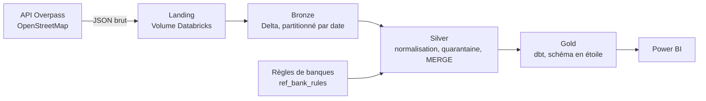

# Morocco Bank Network Lakehouse

Pipeline de données qui collecte les agences bancaires du Maroc depuis OpenStreetMap,
les normalise et les historise dans un lakehouse Delta sur Databricks.

**Objectif métier :** mesurer la répartition du réseau bancaire par banque et par région,
comme base d'une analyse de l'inclusion financière.

> Projet en cours. Les phases terminées sont indiquées ci-dessous.

## Architecture



## Avancement

| Phase | Contenu | État |
|---|---|---|
| Ingestion | Appel Overpass avec retries et backoff exponentiel, contrôle du volume avant écriture | Terminé |
| Bronze | Table Delta, schéma explicite, partition par date, relance idempotente (`replaceWhere`) | Terminé |
| Silver | Normalisation multilingue des banques, classification des établissements, quarantaine, `MERGE` incrémental avec détection des changements et des fermetures | Terminé |
| Gold | Modèle en étoile et historique SCD2 avec dbt | À venir |
| Orchestration | Databricks Jobs | À venir |
| Tests et CI | pytest, GitHub Actions | À venir |

## Chiffres clés (collecte du 6 novembre 2026)

- 2 728 objets OpenStreetMap marqués comme banque au Maroc
- 97,6 % des agences avec un nom rattachées à un établissement normalisé
- 0 rattachement ambigu (règles priorisées et départage déterministe)
- 125 points identifiés comme établissements non bancaires (transfert d'argent, crédit, change)

## Choix techniques

- **Tags OSM en `map`** en bronze, pour conserver tous les tags sans créer des centaines de colonnes.
- **Règles de normalisation dans une table de référence**, séparées du code : ajouter une variante ne demande pas de modifier le pipeline.
- **Empreinte SHA-256 des colonnes métier** pour ne réécrire que les agences modifiées.
- **Agences disparues désactivées, pas supprimées** (`is_active = false`), pour garder l'historique.

## Limites connues

- OpenStreetMap n'est pas exhaustif : les résultats décrivent le réseau tel qu'il est cartographié, pas le réseau officiel complet.
- Un changement dans OSM peut être une correction de la carte plutôt qu'une ouverture ou une fermeture réelle.
- 181 points restent non identifiés (sans nom ou nom non reconnu).

## Structure du dépôt

```
notebooks/   Notebooks Databricks (ingestion, bronze, exploration, règles, silver)
src/         Code Python réutilisable
tests/       Tests
```

## Source des données

© les contributeurs d'OpenStreetMap. Données disponibles sous licence
[ODbL](https://opendatacommons.org/licenses/odbl/).
